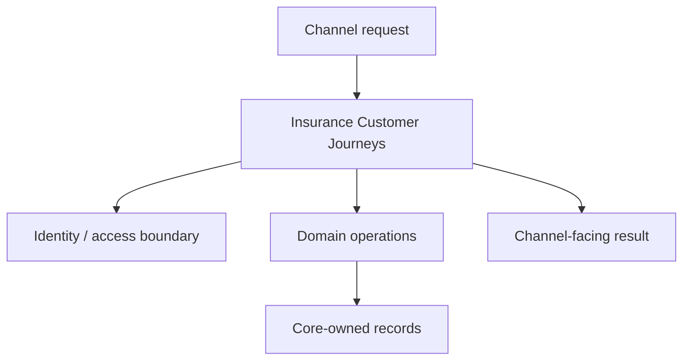

<a href="https://fireflysoftware.io/openplatform/">
<picture>
  <source media="(max-width: 640px) and (prefers-color-scheme: dark)" srcset="https://raw.githubusercontent.com/fireflysoftwaresolutions/.github/main/profile/assets/banner-narrow-dark.svg">
  <source media="(max-width: 640px)" srcset="https://raw.githubusercontent.com/fireflysoftwaresolutions/.github/main/profile/assets/banner-narrow-light.svg">
  <source media="(prefers-color-scheme: dark)" srcset="https://raw.githubusercontent.com/fireflysoftwaresolutions/.github/main/profile/assets/banner-dark.svg">
  
</picture>
</a>

# Insurance Customer Journeys

Experience API for quotes, policy binding requests, first-notice-of-loss, and policy/claim servicing in Firefly OpenPlatform.

[Platform documentation](https://docs.fireflysoftware.io/) · [Source reference](docs/openplatform/reference.md) · [Source inventory](docs/openplatform/source-inventory.json)

## Purpose, scope, and readiness

This service coordinates quote, policy, claim and servicing requests through the existing insurance domain ports. Business records remain owned by the corresponding core services. Binding is fenced before policy creation or document issuance.

The exact focused source passed retained normal unselected verification: 229 tests, comprising 187 corrected-starter, 34 insurance-core and eight insurance-web tests, with zero failures/errors/skips. Seven separate actual generated-client HTTP checks qualify refusal behavior with explicit synthetic collaborators and zero policy/document effects. Independent read-only source/artifact review accepted that bounded local packet. This does not establish positive binding or deployed customer authority. The corrected starter was qualified privately; real-consumer distribution remains separate. Read the [insurance binding decision boundary](docs/insurance-bind-decision-boundary.md).

## Business ownership and supported journeys

Coordinate underwriting, policies, and claims through their existing domain boundaries, keeping the customer and related record references consistent.

A successful sequence of domain record calls is not complete insurer underwriting, legally effective binding, premium collection, or indemnity settlement.

| Entry point | Declared operations |
| --- | --- |
| [InsuranceController](exp-insurance-web/src/main/java/io/fireflysoftware/experience/insurance/web/controllers/InsuranceController.java) | `GET /api/v1/experience/insurance/quotes/{submissionId}`; `GET /api/v1/experience/insurance/policies/{policyId}`; `GET /api/v1/experience/insurance/claims/{claimId}`; 12 more declarations |

The complete [operation reference](docs/openplatform/reference.md#http-operations) lists each mapping and its owning method. These are source declarations; conditional beans, inherited controllers, security filters, and deployment routing can change the effective runtime API.

## Consumer example: serialize a policy through the generated domain SDK

Start with this repository-owned executable contract before connecting a full runtime. Use the JDK required by the effective parent, Maven, and the matching internal artifacts. The selected test defines its own collaborators; no provider credentials should be added to it. Run from this repository root:

```sh
mvn -B -pl exp-insurance-core -am test -DskipOpenApiGen \
  -Dtest=HttpPolicyClientTest -Dsurefire.failIfNoSpecifiedTests=false
```

Runtime integration remains gated on the service configuration and selected adapters described below. The local port and bean-selection inventory below distinguishes the declared abstraction from its configured implementation. An SDK client is an outbound integration; its presence does not establish a working provider connection. Where a sandbox adapter is selected, its behavior is synthetic and limited to what that adapter implements.

**Inputs and fixture ownership.** The complete linked test class supplies its imports, setup, synthetic IDs and collaborators. Run that class as shown; the excerpt is not a standalone Java program. The test uses a local HTTP fixture; it does not connect to the production downstream service. For a deployed call, replace fixture IDs with IDs returned by the owning record-creation API and keep tenant/parent associations intact. The request values and assertions below describe this test boundary only.

```java
@ParameterizedTest
    @EnumSource(LineOfBusiness.class)
    void createSerializesPartyAndPolicyFieldsThroughTheActualGeneratedSdk(LineOfBusiness business) {
        UUID tenant = UUID.randomUUID();
        UUID contract = UUID.randomUUID();
        UUID product = UUID.randomUUID();
        UUID party = UUID.randomUUID();
        var command = new PolicyCommand(tenant, contract, product, party, "SYNTHETIC-001", business,
                PolicyStatus.QUOTE, LocalDate.of(2026, 11, 1), LocalDate.of(2027, 11, 1), "USD");

        StepVerifier.create(client.create(command, PolicyStatus.QUOTE)).assertNext(result -> {
            assertThat(result.id()).isEqualTo(policyId);
            assertThat(result.reference()).isEqualTo("SYNTHETIC-001");
        }).verifyComplete();

        JsonNode request = sent.get();
        assertThat(request).isNotNull();
        assertThat(request.path("partyId").asText()).isEqualTo(party.toString());
        assertThat(request.path("tenantId").asText()).isEqualTo(tenant.toString());
        assertThat(request.path("contractId").asText()).isEqualTo(contract.toString());
        assertThat(request.path("productId").asText()).isEqualTo(product.toString());
        assertThat(request.path("policyNumber").asText()).isEqualTo("SYNTHETIC-001");
        assertThat(request.path("lineOfBusiness").asText()).isEqualTo(business.name());
        assertThat(request.path("policyStatus").asText()).isEqualTo("QUOTE");
        assertThat(request.path("inceptionDate").asText()).isEqualTo("2026-11-01");
        assertThat(request.path("expiryDate").asText()).isEqualTo("2027-11-01");
        assertThat(request.path("currency").asText()).isEqualTo("USD");
    }
```

**Expected behavior.** The parameterized test covers every LineOfBusiness. It checks tenant, contract, product and customer-party UUIDs, policy number, QUOTE status, inception/expiry dates, and USD in the actual generated request body.

**Verification and recovery.** Run the complete selected test class and inspect its Surefire result: zero failures/errors and at least one executed test are required. A skipped or zero-test build is not evidence. Compare the assertions with the owning DTO/service before extending the request. For a runtime run, separately configure authentication/entitlements and the exact downstream endpoints, migrate/seed disposable owner stores, and reread the returned identifier; these unit/contract fixtures do not establish those prerequisites.

**Execution evidence.** This generated domain-SDK capture test is part of the retained focused insurance-core qualification. Its loopback HTTP collaborator is synthetic. The full private reactor has 229 passing tests; seven separate generated experience-SDK HTTP checks cover refusals using the actual candidate controller/service. No policy persistence, positive binding, deployed identity or live-provider acceptance is established.

Source of this example: [HttpPolicyClientTest](exp-insurance-core/src/test/java/io/fireflysoftware/experience/insurance/core/adapter/HttpPolicyClientTest.java), [LineOfBusiness](exp-insurance-core/src/main/java/io/fireflysoftware/experience/insurance/core/journey/LineOfBusiness.java), [PolicyCommand](exp-insurance-core/src/main/java/io/fireflysoftware/experience/insurance/core/journey/PolicyCommand.java), [PolicyStatus](exp-insurance-core/src/main/java/io/fireflysoftware/experience/insurance/core/journey/PolicyStatus.java).

## Architecture and repository layout



| Module | Responsibility |
| --- | --- |
| [exp-insurance-core](exp-insurance-core/) | Application services, handlers, and business coordination; inspect these implementations for lifecycle rules. |
| [exp-insurance-web](exp-insurance-web/) | HTTP entry points, boot application, and runtime configuration. |
| [exp-insurance-sdk](exp-insurance-sdk/) | Client artifact and OpenAPI generation configuration; build it from the matching service contract. |

## Contracts, data, authentication, and errors

Binding requires an explicit partyId; a contract UUID cannot substitute for it. Missing party returns 400, REFER returns 409, DECLINE retains 422, and absent observations/outcomes return 503. APPROVE returns 503 INSURANCE_BINDING_UNAVAILABLE before policy/document effects. The optional X-Idempotency-Key is ignored and supplies no authority or durable receipt. The genuine OpenAPI describes 15 controller operations across 12 paths and eight models.

| Data type | Declared fields (selection) |
| --- | --- |
| [ClaimCommand](exp-insurance-core/src/main/java/io/fireflysoftware/experience/insurance/core/journey/ClaimCommand.java) | `tenantId`, `policyId`, `claimNumber`, `claimStatus`, `lossDate`, `notifiedAt`, `causeCode` |
| [InsuranceRecord](exp-insurance-core/src/main/java/io/fireflysoftware/experience/insurance/core/journey/InsuranceRecord.java) | `id`, `reference`, `status`, `documentId` |
| [JourneySettings](exp-insurance-core/src/main/java/io/fireflysoftware/experience/insurance/core/journey/JourneySettings.java) | `enabled`, `defaultSubmissionStatus`, `defaultPolicyStatus`, `defaultClaimStatus` |
| [PolicyCommand](exp-insurance-core/src/main/java/io/fireflysoftware/experience/insurance/core/journey/PolicyCommand.java) | `tenantId`, `contractId`, `productId`, `partyId`, `policyNumber`, `lineOfBusiness`, `policyStatus` |
| [QuoteCommand](exp-insurance-core/src/main/java/io/fireflysoftware/experience/insurance/core/journey/QuoteCommand.java) | `tenantId`, `partyId`, `productId`, `submissionNumber`, `lineOfBusiness`, `submissionStatus`, `currency` |
| [ReasonCommand](exp-insurance-core/src/main/java/io/fireflysoftware/experience/insurance/core/journey/ReasonCommand.java) | `reason` |
| [AccessDecision](exp-insurance-core/src/main/java/io/fireflysoftware/experience/insurance/core/ports/AccessDecision.java) | `allowed`, `reason` |
| [AccessRequest](exp-insurance-core/src/main/java/io/fireflysoftware/experience/insurance/core/ports/AccessRequest.java) | `actorId`, `action`, `resourceType`, `resourceId` |
| [CreditReportQuery](exp-insurance-core/src/main/java/io/fireflysoftware/experience/insurance/core/ports/CreditReportQuery.java) | `partyId`, `productId`, `journeyStep`, `attributes` |
| [CreditReportView](exp-insurance-core/src/main/java/io/fireflysoftware/experience/insurance/core/ports/CreditReportView.java) | `provider`, `reportId`, `score`, `status`, `illustrative` |
| [DecisionRequest](exp-insurance-core/src/main/java/io/fireflysoftware/experience/insurance/core/ports/DecisionRequest.java) | `partyId`, `productId`, `journeyStep`, `attributes` |
| [DecisionResult](exp-insurance-core/src/main/java/io/fireflysoftware/experience/insurance/core/ports/DecisionResult.java) | `outcome`, `reasonCodes` |

The [data contract reference](docs/openplatform/reference.md#data-contracts) indexes **13 DTO, record, or entity declarations** and their fields. Read DTO validation annotations together with service logic and migrations; a field's presence does not establish that every endpoint accepts it.

The legacy journey still uses a sample identity and its general web security permits requests. Verified current identity, tenant/resource policy, owner associations and per-call delegation remain prerequisites before deployed customer acceptance. Positive binding also requires immutable accepted quote/revision/action evidence, recoverable atomic owner policy/history/audit/outbox outcomes and a governed insurance document profile.

Examples of locally enforced failure or access behavior:

| Declared check or failure | Implementation |
| --- | --- |
| `new IllegalArgumentException("partyId and journeyStep are required"));` | [DomainDecisionConfiguration](exp-insurance-core/src/main/java/io/fireflysoftware/experience/insurance/core/adapter/DomainDecisionConfiguration.java) |
| `new IllegalStateException("DOMAIN_RESPONSE_UNREADABLE");` | [DomainDecisionConfiguration](exp-insurance-core/src/main/java/io/fireflysoftware/experience/insurance/core/adapter/DomainDecisionConfiguration.java) |
| `new BusinessException(HttpStatus.BAD_REQUEST, "VALIDATION_FAILED", name + " is required");` | [HttpInsuranceConfiguration](exp-insurance-core/src/main/java/io/fireflysoftware/experience/insurance/core/adapter/HttpInsuranceConfiguration.java) |
| `new UncheckedIOException(ex);` | [SandboxJourneyCatalogAdapter](exp-insurance-core/src/main/java/io/fireflysoftware/experience/insurance/core/adapter/SandboxJourneyCatalogAdapter.java) |
| `new BusinessException(HttpStatus.BAD_REQUEST, "INSURANCE_PARTY_REQUIRED",` | [InsuranceJourneyService](exp-insurance-core/src/main/java/io/fireflysoftware/experience/insurance/core/journey/InsuranceJourneyService.java) |
| `new BusinessException(HttpStatus.SERVICE_UNAVAILABLE,` | [InsuranceJourneyService](exp-insurance-core/src/main/java/io/fireflysoftware/experience/insurance/core/journey/InsuranceJourneyService.java) |

The [security and failure reference](docs/openplatform/reference.md#security-and-failure-evidence) links local authorization annotations, status mappings, and exception sites. Framework or gateway policy is additional to this local inventory; verify the deployed filter chain and caller entitlements before integration.

## External dependencies, sandbox behavior, and replacement

The local port and bean-selection inventory below distinguishes the declared abstraction from its configured implementation. An SDK client is an outbound integration; its presence does not establish a working provider connection. Where a sandbox adapter is selected, its behavior is synthetic and limited to what that adapter implements.

| Local boundary | Contract methods |
| --- | --- |
| [JourneyCatalogPort](exp-insurance-core/src/main/java/io/fireflysoftware/experience/insurance/core/journey/JourneyCatalogPort.java) | `Mono<JourneySettings> current(UUID productId)` |
| [CreditReportPort](exp-insurance-core/src/main/java/io/fireflysoftware/experience/insurance/core/ports/CreditReportPort.java) | `Mono<CreditReportView> request(CreditReportQuery query)` |
| [DecisionPort](exp-insurance-core/src/main/java/io/fireflysoftware/experience/insurance/core/ports/DecisionPort.java) | `Mono<DecisionResult> decide(DecisionRequest request)` |

All collected interface signatures appear in the [port reference](docs/openplatform/reference.md#ports-and-service-contracts).

Actual bean selection conditions:

| Selector | Declared in |
| --- | --- |
| `name = "firefly.experience.access.adapter", havingValue = "domain", matchIfMissing = true` | [DomainAccessConfiguration](exp-insurance-core/src/main/java/io/fireflysoftware/experience/insurance/core/adapter/DomainAccessConfiguration.java) |
| `name = "firefly.experience.decision.adapter", havingValue = "domain", matchIfMissing = true` | [DomainDecisionConfiguration](exp-insurance-core/src/main/java/io/fireflysoftware/experience/insurance/core/adapter/DomainDecisionConfiguration.java) |
| `name = "firefly.experience.credit-report.adapter", havingValue = "sandbox", matchIfMissing = true` | [SandboxCreditReportAdapter](exp-insurance-core/src/main/java/io/fireflysoftware/experience/insurance/core/adapter/SandboxCreditReportAdapter.java) |
| `name = "firefly.experience.decision.adapter", havingValue = "sandbox"` | [SandboxDecisionAdapter](exp-insurance-core/src/main/java/io/fireflysoftware/experience/insurance/core/adapter/SandboxDecisionAdapter.java) |
| `name = "firefly.experience.insurance.catalog", havingValue = "sandbox", matchIfMissing = true` | [SandboxJourneyCatalogAdapter](exp-insurance-core/src/main/java/io/fireflysoftware/experience/insurance/core/adapter/SandboxJourneyCatalogAdapter.java) |

Implemented adapter classes:

| Implementation | Boundary / available methods | Mode evidence |
| --- | --- | --- |
| [SandboxCreditReportAdapter](exp-insurance-core/src/main/java/io/fireflysoftware/experience/insurance/core/adapter/SandboxCreditReportAdapter.java) | `CreditReportPort`; `request` | Synthetic adapter |
| [SandboxDecisionAdapter](exp-insurance-core/src/main/java/io/fireflysoftware/experience/insurance/core/adapter/SandboxDecisionAdapter.java) | `DecisionPort`; `decide` | Synthetic adapter |
| [SandboxJourneyCatalogAdapter](exp-insurance-core/src/main/java/io/fireflysoftware/experience/insurance/core/adapter/SandboxJourneyCatalogAdapter.java) | `JourneyCatalogPort`; `current` | Synthetic adapter |

For a project-specific provider, implement the existing typed boundary and select it through the repository wiring. Preserve the caller-visible validation, lifecycle, error, correlation, and retry semantics; verify both successful and failed requests against the same contract. Supply endpoint/credentials through configuration. If no sandbox selector is listed, do not invent one or silently introduce sample success as a fallback.

## Configuration and local setup

Runtime configuration sources: [openapi.yml](exp-insurance-sdk/src/main/resources/openapi.yml), [ExpInsuranceApplication.java](exp-insurance-web/src/main/java/io/fireflysoftware/experience/insurance/web/ExpInsuranceApplication.java), [application.yaml](exp-insurance-web/src/main/resources/application.yaml).

| Environment variable or property | Declared fallback |
| --- | --- |
| `api-configuration.domain-platform.security-center.base-path` | `http://localhost:8085` |
| `api-configuration.domain-platform.lending-credit-scoring.base-path` | `http://localhost:8042` |
| `api-configuration.domain-platform.insurance-underwriting.base-path` | `http://localhost:8073` |
| `api-configuration.domain-platform.insurance-policies.base-path` | `http://localhost:8071` |
| `api-configuration.domain-platform.insurance-claims.base-path` | `http://localhost:8072` |
| `firefly.insurance.contracts-base-url` | `http://localhost:8080` |
| `SERVER_PORT` | `8108` |
| `ENDPOINT_DOMAIN_CORE_SECURITY_CENTER` | `http://localhost:8085` |
| `ENDPOINT_DOMAIN_LENDING_CREDIT_SCORING` | `http://localhost:8042` |
| `ENDPOINT_DOMAIN_INSURANCE_UNDERWRITING` | `http://localhost:8073` |
| `ENDPOINT_DOMAIN_INSURANCE_POLICIES` | `http://localhost:8071` |
| `ENDPOINT_DOMAIN_INSURANCE_CLAIMS` | `http://localhost:8072` |

See the [complete configuration reference](docs/openplatform/reference.md#configuration) for every placeholder and its source, including differences between profiles. A fallback is a code default, not a deployment recommendation. Secret defaults are redacted.

Build coordinates: `io.fireflysoftware:exp-insurance:26.10.6`. Parent: `io.fireflysoftware:firefly-parent:26.10.6`. The POM is the compatibility source of truth.

Use the CI-declared JDK `25` and Maven available on your path. This root POM declares `java.version` / compiler release `25`; a lower source target does not lower the JDK needed to consume framework dependencies. Resolve the parent/BOM and internal SDK artifacts before launching a child module. The framework baseline comes through `firefly-parent`; provider adapters should use the corresponding Jafly modules instead of duplicating framework infrastructure.

```sh
mvn --version
mvn -B verify
```

`verify` compiles the reactor and executes the checks bound by the effective POM. A successful dependency resolution or skipped-test package is not a test result. SDK generation may require a running API specification endpoint; inspect the SDK POM before selecting its generation profile.

The current OpenPlatform parent enables `generate-openapi` when `skipOpenApiGen` is absent. Applicable web modules start an OpenAPI generation application on port **18080**, fetch `/v3/api-docs.yaml`, and stop it during the integration-test lifecycle. To validate code against the checked-in API specification without that application-startup step, use:

```sh
mvn -B verify -DskipOpenApiGen
```

This switch does not skip tests or the SDK module's own source generation. It does omit fresh application-generated OpenAPI evidence; run the complete configured lifecycle when qualifying an API change.

After dependencies and configuration are ready, build/install reactor artifacts and launch the web module:

```sh
mvn -B install
mvn -pl exp-insurance-web spring-boot:run
```

Run against disposable local infrastructure first. Supply endpoint/database variables from the configuration reference; a default localhost URL does not start that dependency.

Locally declared build plugins: `maven-compiler-plugin`, `openapi-generator-maven-plugin`, `spring-boot-maven-plugin`. Inherited checks remain governed by the parent POM.

The checkout contains **6 test source/resource files**. See the [test source index](docs/openplatform/reference.md#test-sources) for coverage locations. This inventory is not evidence that those tests passed.

CI definitions: [release.yml](.github/workflows/release.yml).

## Operations and recovery

On failure, retain the request and business record identifiers, inspect the owning controller/service and downstream status, then verify the current persisted state before retrying. Distinguish invalid input, denied access, missing records, and unavailable infrastructure. Avoid replaying a financial or externally visible action until its prior effect is known. For persistent modules, review the migration history and use the deployment rollback procedure; do not erase records to recover a failed request.

Existing test scenarios provide concrete starting points for failure reproduction:

- `createSerializesPartyAndPolicyFieldsThroughTheActualGeneratedSdk` — [HttpPolicyClientTest](exp-insurance-core/src/test/java/io/fireflysoftware/experience/insurance/core/adapter/HttpPolicyClientTest.java)
- `missingExplicitStatusUsesTheConfiguredDefaultInTheTypedRequest` — [HttpPolicyClientTest](exp-insurance-core/src/test/java/io/fireflysoftware/experience/insurance/core/adapter/HttpPolicyClientTest.java)
- `create_callsUnderwritingSdk` — [HttpUnderwritingClientTest](exp-insurance-core/src/test/java/io/fireflysoftware/experience/insurance/core/adapter/HttpUnderwritingClientTest.java)
- `createQuote_callsUnderwritingAfterDecision` — [InsuranceJourneyServiceTest](exp-insurance-core/src/test/java/io/fireflysoftware/experience/insurance/core/journey/InsuranceJourneyServiceTest.java)
- `createQuote_declineDoesNotCallUnderwriting` — [InsuranceJourneyServiceTest](exp-insurance-core/src/test/java/io/fireflysoftware/experience/insurance/core/journey/InsuranceJourneyServiceTest.java)
- `createQuote_deniedActorDoesNotCallDecisionOrDomain` — [InsuranceJourneyServiceTest](exp-insurance-core/src/test/java/io/fireflysoftware/experience/insurance/core/journey/InsuranceJourneyServiceTest.java)
- `bind_approvedDecisionFailsBeforePolicyOrLegacyDocumentEffects` — [InsuranceJourneyServiceTest](exp-insurance-core/src/test/java/io/fireflysoftware/experience/insurance/core/journey/InsuranceJourneyServiceTest.java)
- `bind_repeatedSubscriptionCannotCreateAnotherPolicy` — [InsuranceJourneyServiceTest](exp-insurance-core/src/test/java/io/fireflysoftware/experience/insurance/core/journey/InsuranceJourneyServiceTest.java)

## Compatibility and validation boundaries

The published `exp-insurance-sdk:26.10.6` exposes five bodyless calls through `QuotesApi`, `PoliciesApi` and `ClaimsApi`. The genuine controller contract generates `InsuranceControllerApi` with 15 typed operations and request/response models. The three earlier API classes are absent, and `bindPolicy()` becomes `bind(PolicyCommand, String)`. This is a source and binary compatibility break; the ten additional operations already existed in controller source but were missing from the old YAML.

Migrate imports and rebuild callers against the new API. Supply typed request bodies for create/update/status and applicable servicing operations; obtain tenant, product, contract, policy and party identifiers from their owners. Binding requires an explicit `PolicyCommand.partyId`; a contract or policy ID cannot replace it. Responses use `InsuranceRecord` rather than the published SDK's `Void` results. A typed bind request still returns the documented refusal; it does not enable issuance.

Retaining the optional ignored bind header preserves only the local typed candidate signature. It does not preserve the published five-call SDK API. A future coordinated version bump, downstream migration and independent approval are required before publishing this contract. Do not overwrite the existing same-version artifact or add handwritten SDK/YAML compatibility shims. See the [binding guide](docs/insurance-bind-decision-boundary.md#generated-client-migration) for the method mapping.


Platform and framework coordinates are enumerated in the [build reference](docs/openplatform/reference.md#build-and-dependencies). Keep the API/SDK and parent/BOM release line aligned; an omitted dependency version is managed upstream, not independently pinned here.

Documentation generation checks source freshness and local references. It does not certify compilation, test success, database migration safety, provider connectivity, regulatory approval, or end-to-end customer acceptance.

## Further reading, contribution, and license

- [Insurance binding decision boundary](docs/insurance-bind-decision-boundary.md)

Contributions should describe the affected business contract, update its tests and documentation together, and include the configured verification results. Review the source reference before changing public types or dependency boundaries.

Use is governed by the repository [license](LICENSE).

<!-- Maintained by .github/scripts/documentation/generate.py and curated.json. Edit editorial inputs, then regenerate. -->
